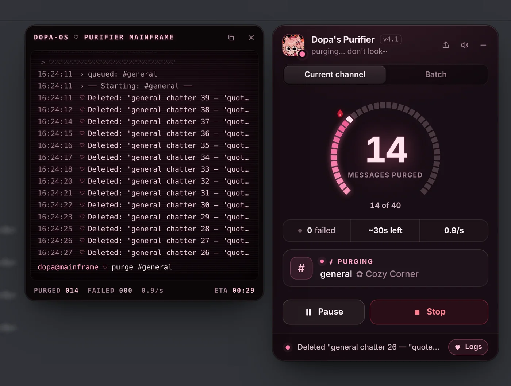

# Dopa's Discord Purifier ✨

Wipe every message *you* sent in a DM, group or server — gently, in a few clicks.
Nothing else is touched.

<p align="center"></p>

## Get it

**→ [codemaker66.github.io/discord-stuff](https://codemaker66.github.io/discord-stuff/)**

That page works out which browser you're on, walks you through the two-minute setup,
and ticks itself off once the purifier is installed. It's also the link to send a friend.

Already have Tampermonkey or Violentmonkey?
[Install the script directly](https://raw.githubusercontent.com/codemaker66/discord-stuff/main/dist/dopas-discord-purifier.user.js) —
it updates itself from the same link.

On the Discord desktop app with BetterDiscord? Drop
[`DopasPurifier.plugin.js`](https://codemaker66.github.io/discord-stuff/downloads/DopasPurifier.plugin.js)
into your plugins folder and switch it on. Each time Discord starts it looks for a new version
and asks before updating itself.

## What it does

- **Scan** any chat to see how many of your messages are in it and how long a purge takes.
- **Hold to purify** — no accidental clicks.
- **Batch**: tick DMs, groups and server channels (threads and forum posts included), then purge them in one go.
- **Shield** anyone and their chat is immune. Bardo is shielded from the start ♡
- Paces itself to Discord's rate limits, pauses and resumes, and tells you honestly what was skipped.

It runs inside Discord in your own browser, with the session you're already logged in with,
and talks to Discord and nothing else.

## Working on it

```sh
npm install
npm run build   # src/ → dist/ (userscript + BetterDiscord plugin) and docs/
npm run check   # fails if dist/ or docs/ are out of date with src/
npm test        # end-to-end tests against a mock Discord (Playwright + Chromium)
node test/site.mjs                                   # install-page tests
node test/shots.mjs dist/dopas-discord-purifier.user.js test/out/shots 2 --showcase   # every UI state, at the shipped pace
python3 tools/marketing.py test/out/shots            # those shots → docs/img/*.webp and the og.png link preview
```

Edit `src/`, never `dist/` — the build rewrites it. Bump `version` in `package.json` to ship an
update: installed copies pick it up from `dist/` on `main` (the BetterDiscord plugin asks first), and the
install page shows the new version.

When the panel changes, retake the page's pictures with the two commands above. `tools/marketing.py`
needs Python 3, Pillow and the Inter font (it finds it with `fc-match`). It refuses shots taken at any
pace but the shipped one, so no picture promises a speed the purifier doesn't have.

Made with ♡ by Bardo & Dopa · not affiliated with Discord
