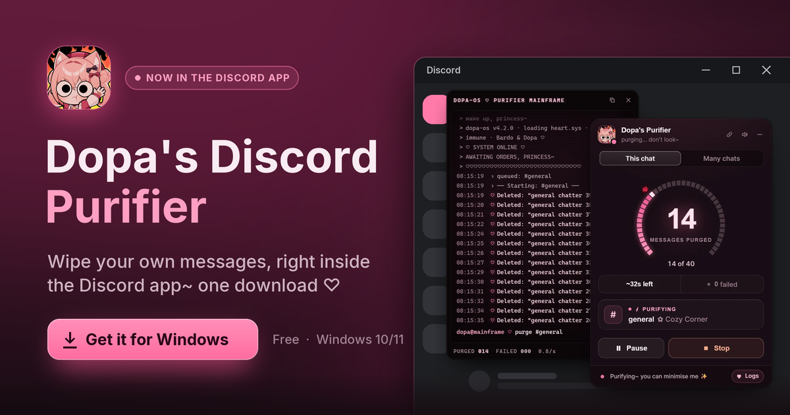

<p align="center">
  <a href="https://github.com/codemaker66/discord-stuff/releases/latest/download/DopasPurifierSetup.exe">
    
  </a>
</p>

<h2 align="center">
  <a href="https://github.com/codemaker66/discord-stuff/releases/latest/download/DopasPurifierSetup.exe">⬇&nbsp; Download DopasPurifierSetup.exe</a>
</h2>

<p align="center">
  <b>Windows 10/11</b> &nbsp;·&nbsp; free &nbsp;·&nbsp; no admin needed &nbsp;·&nbsp; v{{VERSION}} &nbsp;·&nbsp; {{DATE}}<br>
  <sub>Not on Windows? Use it in your browser instead: <a href="https://codemaker66.github.io/discord-stuff/">codemaker66.github.io/discord-stuff</a></sub>
</p>

---

### Three tiny steps

1. **Download** `DopasPurifierSetup.exe` with the link above.
2. **Run it** from your downloads.
3. **Discord reopens with the Purifier.** Look top-right for the panel, open any chat, then press **Purify** ✨

> [!NOTE]
> **If Windows says “Windows protected your PC”**, that's Microsoft Defender SmartScreen meeting a new app for the
> first time. It doesn't mean anything was found. Press **More info**, then **Run anyway**.
> Want to check the file first? Its SHA-256 is in `SHA256SUMS.txt` below.

### What it installs and changes

- **Vencord**, a popular Discord mod, with **Dopa's Purifier** built in: Vencord {{VENCORD}}, Purifier v{{VERSION}}.
- Vencord's files go in `%APPDATA%\Vencord`, and Discord gets a tiny loader so it starts with Vencord.
  It puts itself back after Discord updates.
- **Your settings stay.** Already on Vencord? Your settings and plugins are kept just as they are.
- **Updates arrive by themselves.** Vencord's updater fetches new builds from this project's releases and
  asks you to restart Discord to wear them.
- No account, no sign-up, no servers of ours. The Purifier runs inside your own Discord with the session
  you're already logged in with.

### How to uninstall

Run `DopasPurifierSetup.exe` again and press **Uninstall**. Discord goes back to plain.

### An honest note

Client mods like Vencord are against Discord's terms, so like any tool of this kind this carries a small risk.
The Purifier works at a human-ish pace, slows down whenever Discord asks, and never runs on its own: you start every
purge. Use it at your own discretion.

---

<details>
<summary><b>Checksums</b></summary>

Every other file in this release is listed in **`SHA256SUMS.txt`**, one `<sha256>  <file name>` line each.
To check the installer in PowerShell:

```powershell
(Get-FileHash .\DopasPurifierSetup.exe -Algorithm SHA256).Hash.ToLower()
```

The result should match the `DopasPurifierSetup.exe` line in `SHA256SUMS.txt`.
`build.json` records what this build is: Purifier `{{VERSION}}`, Vencord `{{VENCORD}}`, commit `{{HASH}}`.

</details>

<details>
<summary><b>Source code and licence (GPL-3.0)</b></summary>

This build contains a modified copy of [Vencord](https://github.com/Vendicated/Vencord), which is licensed under the
[GNU General Public License v3.0](https://www.gnu.org/licenses/gpl-3.0.html). The `patcher.js`, `preload.js`,
`renderer.js` and `renderer.css` files in this release, and the copy the installer sets up, are built from:

- **Vencord**: [Vendicated/Vencord](https://github.com/Vendicated/Vencord) at **{{VENCORD}}**
- **plus** this repository's [`src/`](https://github.com/codemaker66/discord-stuff/tree/{{HASH}}/src) at commit
  [`{{HASH}}`](https://github.com/codemaker66/discord-stuff/commit/{{HASH}}), added to it as a Vencord userplugin

You may use, study, share and change it under the terms of the GPL-3.0. The complete corresponding source is at the
links above, and the build steps are in this repository.

</details>

<p align="center"><sub>Made with ♡ by Bardo &amp; Dopa · not affiliated with Discord or Vencord · <code>{{HASH}}</code></sub></p>
